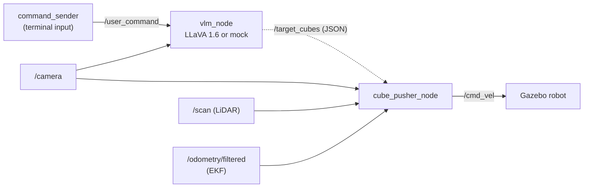

# VLM-Assisted Autonomous Mobile Robot

Autonomous mobile robot for **target detection, collection and transport** in a simulated classroom. It combines a classical ROS 2 stack (EKF localization, SLAM, Nav2, LiDAR-based obstacle checks) with a **Vision-Language Model (LLaVA 1.6)** that interprets natural-language commands and selects which cubes to collect.

Developed and tested in **Gazebo (Ignition)** simulation on ROS 2.


---

## 🧠 How it works



1. You type a command (e.g. *"Collect the red cube"*) in `command_sender`, which publishes it on `/user_command`.
2. `vlm_node` takes the latest camera frame plus the command, queries the VLM (or a keyword-based mock), and publishes the selected cube colours as JSON on `/target_cubes`.
3. `cube_pusher_node` drives the robot to each cube with a state machine (select → arc around the cube if needed → align behind it → approach → push to its colour-coded drop pad → back up), using the filtered odometry and LiDAR.
4. In parallel, the Nav2 stack (AMCL localization + planner/controller) and RViz are available for map-based navigation.

---

## 🗂️ Repository structure

```text
src/
├── URDFF_gz/                # Robot model (URDF/xacro, meshes), classroom world, Gazebo launch, EKF config
├── URDFF_navigation/        # Nav2, AMCL localization and slam_toolbox configs, classroom map
├── URDFF_viz/               # RViz configuration and launcher for navigation
├── URDFF_cube_collector/    # cube_pusher_node: cube detection overlay + push-to-zone state machine
└── vlm_commander/           # vlm_node (LLaVA / mock) and command_sender (terminal client)
```

### Robot and simulation

| Item | Details |
|------|---------|
| Drive | 4-wheel differential drive (wheel separation 0.147 m, wheel radius 0.033 m) |
| LiDAR | YDLIDAR X2-style 2D scan, 462 samples, 0.12 – 8.0 m, 6 Hz (`/scan`) |
| Camera | 1920×1080 at 30 Hz (`/camera`) |
| IMU | 100 Hz (`/imu`) |
| Localization | `robot_localization` EKF fuses `/odom` (wheel velocities) and `/imu` (yaw) into `/odometry/filtered` |
| World | Classroom (10×10 m) with desks and chairs, 4 coloured cubes (red, blue, green, yellow) and a collection zone with four colour-coded drop pads near (-4, -1) |

### Main topics

| Topic | Type | Direction |
|-------|------|-----------|
| `/user_command` | `std_msgs/String` | `command_sender` → `vlm_node` |
| `/target_cubes` | `std_msgs/String` (JSON `{"target_colors": [...]}`) | `vlm_node` → (see [limitations](#-current-status-and-limitations)) |
| `/camera` | `sensor_msgs/Image` | Gazebo → `vlm_node`, `cube_pusher_node` |
| `/scan` | `sensor_msgs/LaserScan` | Gazebo → Nav2, `cube_pusher_node` |
| `/odom`, `/imu` | `nav_msgs/Odometry`, `sensor_msgs/Imu` | Gazebo → EKF |
| `/odometry/filtered` | `nav_msgs/Odometry` | EKF → `cube_pusher_node` |
| `/cmd_vel` | `geometry_msgs/Twist` | `cube_pusher_node` / Nav2 → Gazebo |

---

## ⚙️ Requirements

- Ubuntu 22.04, **ROS 2 Humble**, **Ignition Gazebo** (`ign gazebo`) with `ros_gz_sim` and `ros_gz_bridge`
- ROS packages: `nav2_bringup`, `slam_toolbox`, `robot_localization`, `robot_state_publisher`, `xacro`, `rviz2`, `cv_bridge`, `teleop_twist_keyboard`
- Python packages for `vlm_node`: `torch`, `transformers`, `accelerate`, `bitsandbytes`, `pillow`, `numpy`, `opencv-python`
- For the real VLM: an **NVIDIA GPU with CUDA** (the model is loaded in 4-bit with `bitsandbytes`). The node logs the VRAM used at startup. The weights (`llava-hf/llava-v1.6-mistral-7b-hf`) are downloaded from Hugging Face on the first run.
- A desktop session: `cube_pusher_node` opens OpenCV windows (camera feed with detections, LiDAR top-down view).

> `vlm_node.py` imports `torch` and `transformers` at startup, so they must be installed even when running the mock VLM.

---

## 🔧 Installation

```bash
# Clone directly as the workspace (the repo root contains src/)
git clone https://github.com/Ihebzaouali/VLM-Assisted-Autonomous-Mobile-Robot.git ~/ros2_ws
cd ~/ros2_ws

# ROS dependencies
source /opt/ros/humble/setup.bash
rosdep install --from-paths src --ignore-src -r -y

# Python dependencies for the VLM node
pip install torch transformers accelerate bitsandbytes pillow numpy opencv-python

# Build
colcon build --symlink-install
source install/setup.bash
```

---

## ▶️ Running the project

Open one terminal per step. In every terminal, first run:

```bash
cd ~/ros2_ws
source install/setup.bash
```

**1. Simulation (Gazebo + robot + bridges + EKF)**

```bash
ros2 launch URDFF_gz gazebo.launch.py
```

**2. Nav2 navigation stack** *(optional for the cube-collection demo)*

```bash
ros2 launch URDFF_navigation navigation.launch.py use_sim_time:=true
```

**3. Localization (AMCL + map server)** *(optional for the cube-collection demo)*

```bash
ros2 launch URDFF_navigation localization.launch.py use_sim_time:=true
```

The default map is `URDFF_navigation/maps/classroom_map.yaml`. Use `map:=/path/to/map.yaml` to override it.

**4. RViz** *(optional)*

```bash
ros2 launch URDFF_viz view_navigation.launch.py use_sim_time:=true
```

Set the robot's initial pose with **2D Pose Estimate**, then send goals with **Nav2 Goal**.

**5. Cube collector**

```bash
ros2 run URDFF_cube_collector cube_pusher_node
```

**6. VLM node**

```bash
# Real LLaVA 1.6 (4-bit, needs a CUDA GPU)
ros2 run vlm_commander vlm_node --ros-args -p use_real_vlm:=true

# Mock VLM (keyword matching, no GPU inference)
ros2 run vlm_commander vlm_node
```

If LLaVA fails to load, the node logs the error and falls back to the mock.

**7. Send commands**

```bash
ros2 run vlm_commander command_sender
```

Examples: `Collect the red cubes`, `Go to the blue cube on the left`, `Push all cubes to collection zone`. Type `quit` to exit. The mock VLM understands the colour names (red, blue, green, yellow) and the words *left*, *right*, *center/middle*; anything else selects all cubes.

> Send commands only after the camera is publishing; otherwise `vlm_node` warns that no image is available yet.

### Mapping a new environment

```bash
ros2 launch URDFF_navigation slam.launch.py use_sim_time:=true
ros2 run teleop_twist_keyboard teleop_twist_keyboard
ros2 run nav2_map_server map_saver_cli -f classroom_map
```

---

## 🚧 Current status and limitations

- **VLM → collector link:** `vlm_node` publishes the chosen colours on `/target_cubes`, but `cube_pusher_node` does not subscribe to it yet. The collector currently processes all four cubes, nearest first, regardless of the command.
- **Cube positions are hard-coded** in `cube_pusher_node.py` (`CUBES`) and in the mock VLM. The HSV colour detection is currently shown as an overlay in the camera window and is not used to control the robot. The real VLM returns colours and text descriptions only, not coordinates.
- **Motion control:** `cube_pusher_node` publishes directly on `/cmd_vel` using its own controller; it does not send goals to Nav2. Nav2 and AMCL are set up and usable from RViz.
- Validated in simulation. <!-- Add your physical-robot setup here (hardware, sensors, results) if you want to document it. -->

---

## 🛠️ Troubleshooting

- **Gazebo window is black or fails to start on a machine without an NVIDIA GPU:** `gazebo.launch.py` sets `__NV_PRIME_RENDER_OFFLOAD` and `__GLX_VENDOR_LIBRARY_NAME=nvidia`. Remove these two entries from `additional_env` on non-NVIDIA setups.
- **Meshes not found in Gazebo:** rebuild and re-source the workspace. The launch file rewrites `package://URDFF_gz` paths to absolute `file://` paths in `/tmp/robot_gazebo.urdf`.
- **`vlm_node` is slow on first start:** the model weights are downloaded and loaded into GPU memory once.
- **Out of GPU memory:** run the mock VLM (omit `-p use_real_vlm:=true`).

---

## 📄 License

<!-- TODO: add a LICENSE file (e.g. MIT or Apache-2.0) and align the <license> tags in each package.xml -->
